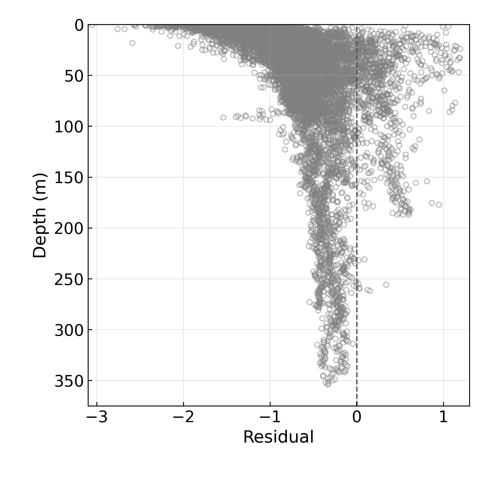
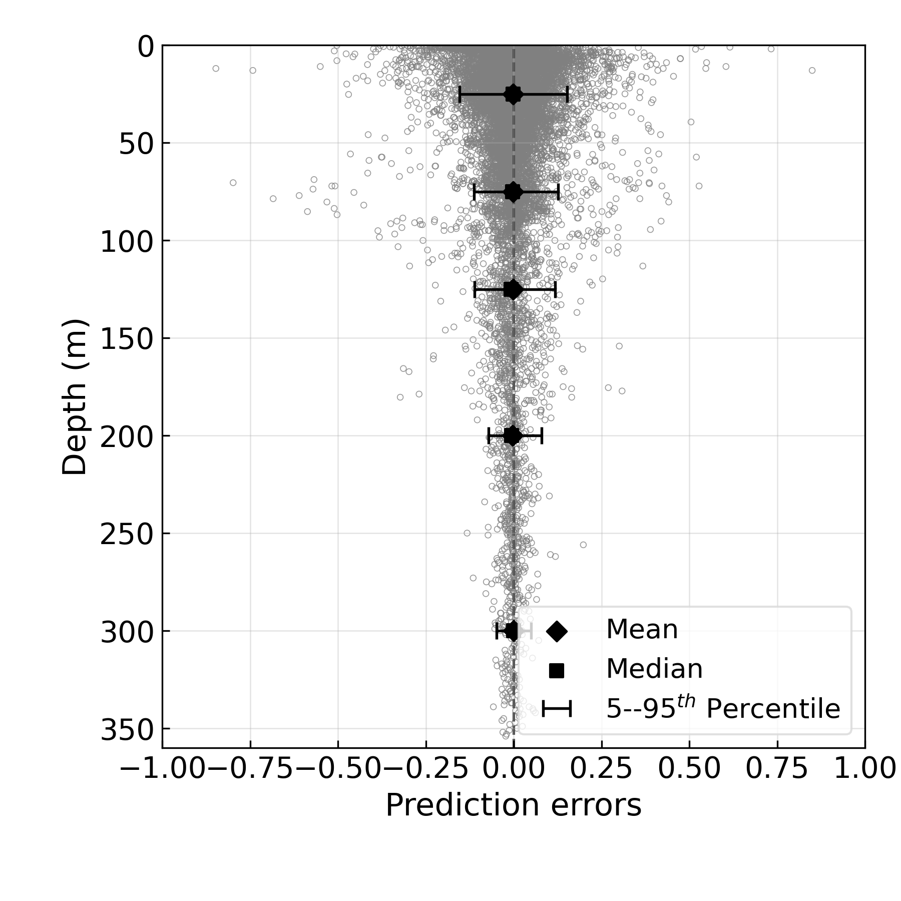
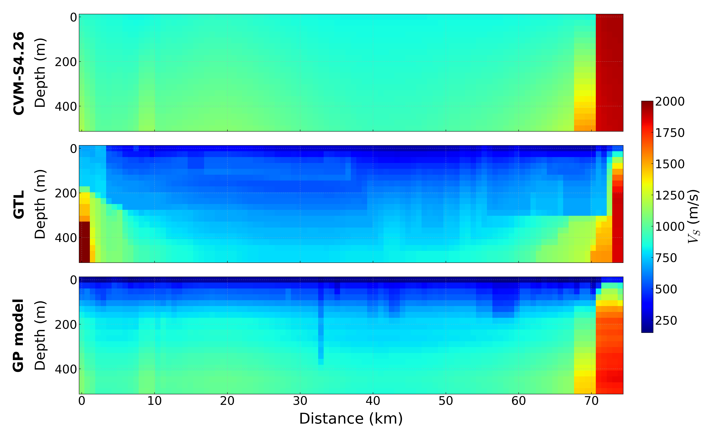
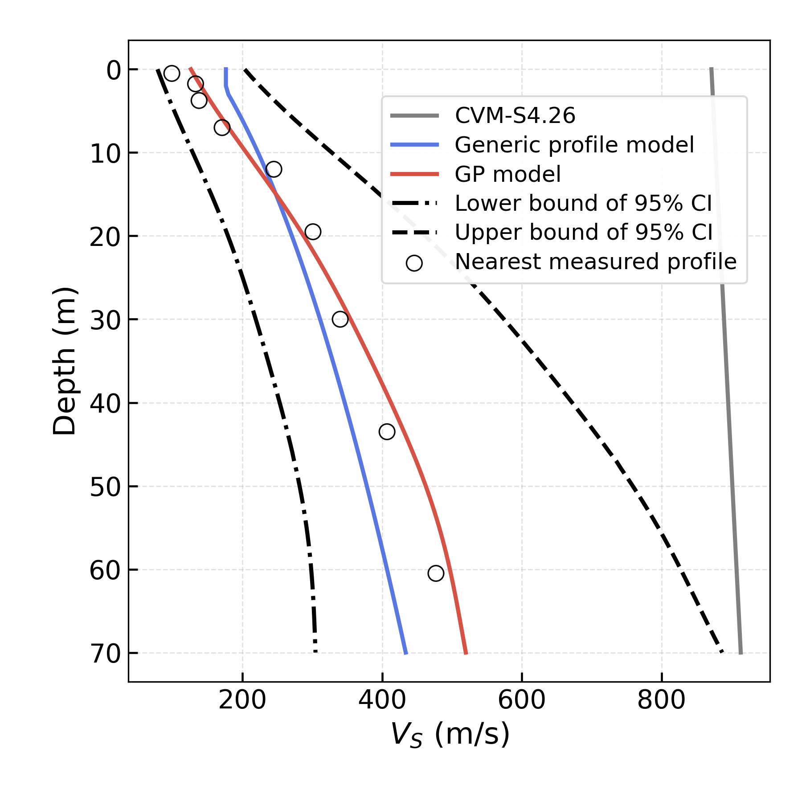

# Gaussian Process of Shallow Seismic Velocity Models in the Los Angeles Basin

A research workflow for refining shallow subsurface shear-wave velocity (Vs) estimates in the Los Angeles Basin using Gaussian Process (GP) regression and existing velocity-model information from the **SCEC Unified Community Velocity Model (UCVM)** ecosystem.

The repository includes velocity-data preprocessing, two-stage GP model training, validation, residual analysis, and applications to selected sites, vertical cross-sections, and regional Vs30 mapping.

## Overview

Accurate near-surface shear-wave velocity estimates are important for characterizing site conditions and seismic wave propagation. This project develops a data-driven adjustment workflow that integrates measured velocity profiles and sonic-log information with baseline UCVM predictions. GP regression models structured discrepancies between measurements and the reference model, with spatial covariance and feature-based components represented in custom GPyTorch kernels.

The code is organized as Jupyter notebooks for reproducible research experiments, with supporting Python modules for kernels, model utilities, plotting, and spatial-data processing. **This is a research codebase, not a packaged or fully automated UCVM replacement.**

## Features

- Clean and harmonize shear-wave velocity measurements, layer data, site metadata, and sonic logs.
- Associate observations with basin geometry and query-derived UCVM attributes.
- Train GP models in two stages using custom covariance kernels.
- Model three-dimensional spatial correlation with an anisotropic Matérn kernel.
- Explore group-aware training objectives using a leave-group-out pseudo-likelihood.
- Validate predictions against available measurements and inspect model residuals.
- Generate comparisons at selected locations, along cross-sections, and on Vs30 maps.
- Reuse included fitted model checkpoints and input scalers for downstream notebook analyses.

## Repository Structure

```text
.
├── Preprocessing/
│   ├── Cleaning_vs_data.ipynb
│   ├── Log-test.ipynb
│   └── Assign_basinid.ipynb
├── Model_training/
│   ├── Model_trainning_step1.ipynb
│   ├── Model_trainning_step2.ipynb
│   ├── newloss.py
│   ├── pylib_gp_noconst.py
│   ├── pylib_gp_twoscale.py
│   └── *.pth, *.pkl
├── Model_validation/
│   ├── Model_validation.ipynb
│   └── pylib_gp_*.py
├── Residual/
│   └── Model_residual.ipynb
├── Application_selected_locations/
│   ├── Model_point1.ipynb
│   └── Model_point2.ipynb
├── Appliction_cross_sections/
│   ├── Model_cross_section-GP.ipynb
│   └── Model_cross_section-GTL.ipynb
├── Application_vs30map/
│   ├── Model_vs30map_prediction.ipynb
│   ├── Model_vs30map_plotting.ipynb
│   └── compare_vel_maps.py
├── Plotting/
│   └── Plotting.ipynb
└── Data/
    ├── Raw_data/
    ├── Vel_data/
    └── Figure/
```

Directory and notebook names are shown exactly as they occur in the source archive, including the original spelling of `Appliction_cross_sections` and `Model_trainning_*`.

## Methodology

### Data preparation

The preprocessing notebooks organize measured Vs points and layers, borehole/sonic-log data, site metadata, basin membership, and baseline UCVM inputs/outputs. The notebooks perform data cleaning, collocated-profile inspection, and feature preparation for model fitting.

### Gaussian Process model

The modeling code uses [PyTorch](https://pytorch.org/) and [GPyTorch](https://gpytorch.ai/). One custom covariance component uses a 3D anisotropic Matérn kernel with the horizontal and vertical distances scaled separately:

$$
r = \sqrt{\frac{(x-x')^2+(y-y')^2}{\ell_{xy}^2} + \frac{(z-z')^2}{\ell_z^2}}, \qquad \ell_z=\alpha\ell_{xy}.
$$

For Matérn smoothness $\nu=5/2$, the kernel takes the form

$$
k(r)=\sigma_f^2\left(1+\sqrt{5}r+\frac{5}{3}r^2\right)e^{-\sqrt{5}r}.
$$

Other custom kernel terms and modeling choices are defined in `Model_training/pylib_gp_twoscale.py` and `Model_training/pylib_gp_noconst.py`. Check the implementation and notebook settings for the exact model configuration used in each experiment.

### Training and validation

The two training notebooks cover hyperparameter estimation and model refinement. `Model_training/newloss.py` implements `LeaveGroupOutPseudoLikelihood`, an objective based on conditional likelihoods for held-out observation groups. `Model_validation/Model_validation.ipynb` evaluates the fitted GP and reports prediction-error metrics including RMSE.

## Installation

Use a Python environment with Jupyter support. Core dependencies observed in the source include:

```bash
python -m venv .venv
source .venv/bin/activate   # Windows: .venv\Scripts\activate
pip install numpy pandas scipy matplotlib torch gpytorch scikit-learn \
    jupyter pyproj geopandas shapely rasterio cartopy networkx openpyxl
```

Additional packages may be required by particular notebooks. The archive does **not** provide a pinned environment/lockfile, so exact dependency versions and compatibility have not been verified. Some optional comparison scripts import external modules not bundled with this repository.

## Usage

Run notebooks from their corresponding folders so their relative paths resolve correctly. The project is primarily notebook-driven; there is no single end-to-end command-line entry point.

**Recommended workflow:**

1. **Preprocess observations:** begin with `Preprocessing/Cleaning_vs_data.ipynb`; use `Log-test.ipynb` for sonic logs and `Assign_basinid.ipynb` for basin association where needed.
2. **Train the model:** run `Model_training/Model_trainning_step1.ipynb` followed by `Model_training/Model_trainning_step2.ipynb`. Review all input paths and hyperparameter settings before execution.
3. **Evaluate:** use `Model_validation/Model_validation.ipynb` and `Residual/Model_residual.ipynb`.
4. **Generate applications:** use `Application_selected_locations/`, `Appliction_cross_sections/`, and `Application_vs30map/` for location-based predictions, section plots, and Vs30 maps.
5. **Visualize results:** consult `Plotting/Plotting.ipynb` and figures under `Data/Figure/`.

Launch the notebook interface with:

```bash
jupyter lab
```

### Using pretrained models

Several analysis folders include files such as:

```text
ucvm_la_basin_adj_model_frozen_newloss.pth
ucvm_la_basin_adj_scaler_frozen.pkl
```

These are serialized model parameters and feature-scaling objects used by the notebooks. Match each checkpoint with the model class and feature preprocessing used to create it. Only load `.pth` and `.pkl` files from sources you trust.

## Example Results

The repository contains figures that can be viewed directly on GitHub:

### Velocity measurements



### Spatial residual patterns



### Cross-section comparison



### Selected location



These images are provided as existing project artifacts, not regenerated by the README.

## Data and Reproducibility Notes

- The supplied archive contains input data, geospatial rasters, intermediate text outputs, figures, and saved models. Some files are large; GitHub's file-size limits may require **Git LFS**, external data hosting, or a smaller public release.
- UCVM input/output files in `Data/Vel_data/` appear to be precomputed. Reproducing the original UCVM queries may require a separately installed/configured UCVM environment.
- Several notebooks refer to relative paths and local research assumptions. Update those references for your setup.
- Third-party velocity measurements, model products, GIS layers, and Vs30 map products can have distinct licenses or citation requirements. Confirm redistribution rights before publishing the full `Data/` directory.
- The repository currently does not include an automated test suite or fully pinned requirements.

## References

- [SCEC Unified Community Velocity Model (UCVM)](https://github.com/SCECcode/UCVM)
- [GPyTorch documentation](https://docs.gpytorch.ai/)
- [PyTorch documentation](https://pytorch.org/docs/stable/index.html)

For academic reuse, cite the underlying velocity datasets, UCVM products, and related research publications as appropriate. Add a project-specific paper citation here if one is available.

## License

No license was specified in the provided archive. Add a `LICENSE` file and clarify any third-party data licenses before public redistribution.
